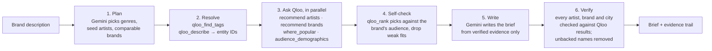

# Drop Scout

**Know who your drop is for.** Drop Scout is an AI agent for small streetwear and merch brands. Describe your brand in two sentences and, in about 20 seconds, it uses Qloo's taste graph to tell you which artists and brands your audience already loves, which cities to pop up in, which upcoming shows to set up next to, and what to drop next. Every name in the brief is checked against Qloo's data before you see it.

Live: **https://drop-scout.onrender.com**. Tap **⚡ See a real example: Smacked** for a saved real run that loads in 2 seconds.

Built for the Qloo Agentic Hackathon (2026).

## The problem

Big brands pay agencies for audience and taste research. Independent brands guess: which artist to collab with, which city to pop up in, what to make next. A plain chatbot guesses too, with confidence. Drop Scout grounds every recommendation in Qloo's cross-domain taste data and shows its evidence.

## Results (tested on 20 brands)

We ran 20 different brand descriptions through the live app, from West Coast streetwear and Atlanta trap to Nashville western, Detroit techno, cottagecore and anime streetwear. Every run was fresh, with no cache.

| Metric | Result |
|---|---|
| Names confirmed by Qloo on the first draft | **97.9%** (326 of 333) |
| Names shown in the final briefs | **100% Qloo-backed** (the 7 unconfirmed names were removed automatically) |
| Average time per scout | **20.6 s** (median 18 s) |
| Live Qloo calls per scout | **~9** |
| Runs completed | 19 of 20 (one Google "model busy" error, now handled by automatic retries) |

## What the agent does



1. **Plan.** Gemini reads the brand and decides what to ask: 1–2 music genres, 3 well-known reference artists, and 3 comparable brands.
2. **Resolve.** Qloo needs entity IDs, not names, so the server turns names into Qloo IDs with `qloo_describe` and finds genre and style tags with `qloo_find_tags`.
3. **Ask Qloo, in parallel.** `qloo_recommend` for artists (seeded with the reference artists and filtered to the genre tags) and for brands, `qloo_where_popular` for the map of where this taste is concentrated, and `qloo_audience_demographics` for the aggregate audience.
4. **Self-check.** `qloo_rank` re-ranks the candidate artists against the comparable brands' audience, and the brands against the artists' audience. Only the strongest fits are kept (6 artists and 5 brands).
5. **Write.** Gemini writes a short brief from that evidence only: audience, artists, brands, pop-up cities, tour tie-ins, what to drop next, and marketing moves.
6. **Verify.** The server parses every bold name in the brief and checks it against what Qloo actually returned. Cities must sit near a Qloo hot spot. Anything unbacked is removed, and the page shows **"✓ Verified by Qloo: N/N names"**.

## The app

- **Live progress** shows each Qloo call as it happens, plus the agent's plan and self-check.
- **Picture tiles** use Qloo's own images, with a ✓ % match score taken from Qloo's affinity.
- **30-second music previews** come from Apple's public iTunes Search API, with an equalizer that reacts to the actual audio.
- **Pop-up globe:** a 3D globe (MapLibre and OpenFreeMap) with Qloo's hot spots. Tap a dot to fly in and see the city, with a Wikipedia photo.
- **Upcoming shows:** Ticketmaster's Discovery API lists concerts by the matched artists, ranked first if they fall in a Qloo hot spot. **Pitch a pop-up** drafts a vendor or merch-table request to the venue, using the Qloo match. The user copies and sends it; nothing is sent automatically.
- **Test a product idea:** type "olive green tracksuit" and Qloo scores how well it fits this audience (0–100), with the brands your fans already love in that lane. The score is relative to the audience's favourite brands overall, so off-lane ideas really do score low (hoodie 98, trucker hat 81, puffer jacket 32, yoga pants 0 for the Smacked audience).
- **Head-to-head:** score two ideas side by side; the better fit gets a badge.
- **Best city for the idea:** the same score, weighted toward each pop-up city, ranks where to drop it first.
- **Compare me to a brand:** type "Supreme" to see the taste match, the taste you share, where each audience leans (yours: Underground Rap; theirs: Street culture), and which artists each side plays.
- **Why this match?** Tap any artist or brand to see the taste tags it shares with your audience.
- **Follow-up questions** ("What about New York?") go back through the agent loop with Qloo tools, using Qloo entity IDs from the brief.
- **Qloo match board:** a scrolling ticker of the brief's match scores.
- **English / Spanish:** the page and the brief can switch to Spanish.

## How we used Qloo

All Qloo access goes through the official **`qloo mcp`** server (`@qloo/qloo-harness`), started once by the Node backend and called over MCP.

| Qloo tool | Used for |
|---|---|
| `qloo_find_tags` | turning genres and styles into Qloo tag URNs |
| `qloo_describe` | resolving artist and brand names to Qloo entity IDs |
| `qloo_recommend` | artists and brands this audience also likes; product-idea scores (with `include_tags`); city ranking (with `signal_location`); follow-up questions |
| `qloo_where_popular` | geographic hot spots for pop-ups (the globe) |
| `qloo_audience_demographics` | aggregate age and gender affinities |
| `qloo_rank` | the self-check that drops weak fits; the match % in "Compare me to a brand" |
| `qloo_compare_audiences` | shared vs. distinct taste in "Compare me to a brand" and the "Why this match?" tags |
| `qloo_trends` | wired up for the ticker; the hackathon dataset returned no trend points, so the ticker shows match scores instead |

We also tried `qloo_entity_tags` for "Why this match?", but it returned non-taste tags (ratings, venue types and demographic labels), so we use `compare_audiences` instead and filter out any demographic tag before display.

## Run it locally

Requirements: Node.js 22.19+, a Qloo hackathon key, and a Google Gemini API key. A Ticketmaster key is optional.

```sh
git clone https://github.com/bswagy/drop-scout.git
cd drop-scout
npm install
export QLOO_API_KEY=...            # never commit keys
export GEMINI_API_KEY=...
export TICKETMASTER_API_KEY=...    # optional: enables upcoming shows
npm run check                      # connects to Qloo and lists tools
npm start                          # http://localhost:3000
```

Optional settings: `GEMINI_MODEL` (default `gemini-flash-latest`), `GEMINI_FALLBACKS`, `PORT`, `QLOO_BASE_URL`.

**Deploy:** run it as a long-lived Node web service (we use Render), because `qloo mcp` runs as a local process. Add the keys as environment secrets.

## Reliability

- Qloo calls in the same step run in parallel, at most two at a time for the extra features, and a "too many requests" reply is retried automatically.
- When Qloo can't resolve an input it returns candidates; the server retries once with Qloo's top candidate.
- Gemini "thinking" is turned down for speed.
- Busy or slow Gemini models are skipped for a few minutes. If every model is busy, the server waits and tries once more, and the page retries once automatically.
- Results are cached for 6 hours per brand description.
- A keep-warm ping stops the free server from sleeping, and the saved Smacked example works even if the AI is down.

## Responsible data use

- Only the brand description is sent to the model. No personal data is sent to Qloo.
- Qloo results describe **aggregate** cultural affinities, never individuals. The audience section uses aggregate demographic affinities only.
- Every name in a brief must come from a Qloo result in that session, and the verifier enforces it.
- Keys live only in server environment variables. The browser never calls Qloo or Gemini directly.
- Pitch emails are drafts. The user decides whether to send them.
- Requests are rate-limited (one scout per 15 seconds per visitor) to respect the event quota.

## Known limitations

- Results depend on how well a brand description maps to Qloo tags; very niche or mixed brands give broader results.
- Affinity is not causation. A hot-spot city is a lead to test, not a sales forecast.
- Pop-up city names come from Qloo's coordinates (the model names the nearest major city, and the verifier checks the distance).
- Trend data was empty in the hackathon dataset, so trend arrows are not shown.

## License

MIT
